# 火焰烟雾检测识别系统（YOLOv8 / YOLO11 / YOLO26 + PyQt5）

面向国内大学生课程设计与毕业设计的火焰烟雾目标检测项目说明。项目提供**YOLOv8、YOLO11、YOLO26三个独立版本**，包含**数据集、训练脚本、训练权重、验证结果、测试素材和PyQt5交互界面**。

> 本仓库页面用于展示项目结构、训练依据和运行效果，不包含完整售卖源码、数据集或权重文件。

## 运行效果

真实PyQt5界面如下。右侧提供**图片、文件夹、视频与摄像头入口**，中间显示检测画面，下方表格记录检测结果。

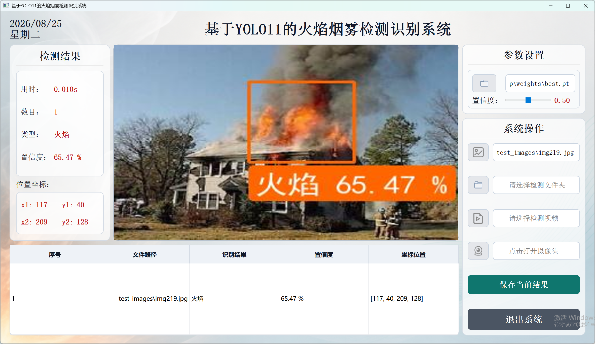

模型对输入画面中的火焰或烟雾进行定位，输出类别、置信度和检测框。

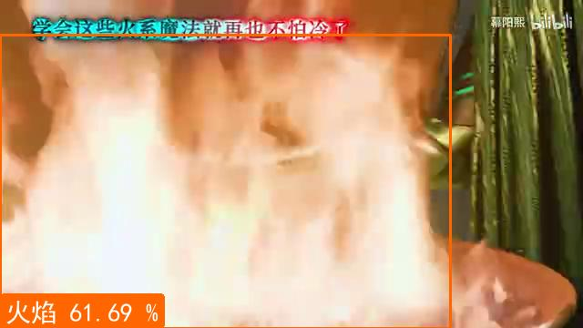

正式运行视频：

https://www.bilibili.com/video/BV1Lu4Q6GEWu/

视频以YOLO11版演示。YOLOv8和YOLO26的界面操作一致，分别加载对应版本的训练权重。

## 主要功能

- 单张图片检测；
- 文件夹批量检测；
- 视频逐帧检测；
- 摄像头实时检测；
- 显示类别、置信度和坐标；
- 将当前检测结果导出为CSV；
- 批量检测过程中再次点击文件夹按钮可停止并重新选择；
- 视频或摄像头运行时再次点击对应按钮可关闭当前输入。

## 项目文件

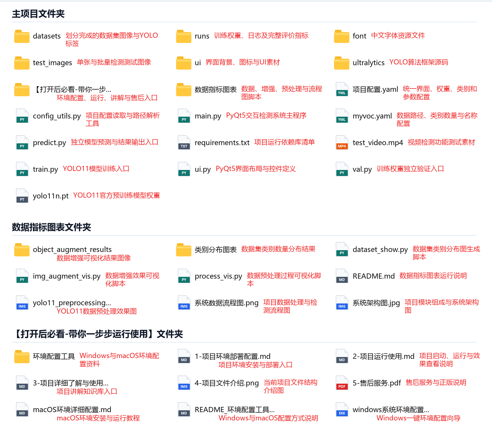

```text
火焰烟雾检测识别_YOLO11_PyQt5_标准成品项目/
├── main.py                     # PyQt5主程序与检测业务
├── ui.py                       # 界面布局
├── predict.py                  # 独立预测入口
├── train.py                    # 模型训练入口
├── val.py                      # 独立验证入口
├── config_utils.py             # 配置读取与路径解析
├── 项目配置.yaml                # 标题、权重、类别与阈值
├── myvoc.yaml                  # 数据集配置
├── requirements.txt            # Python依赖
├── datasets/
│   └── dataset/
│       ├── images/{train,val,test}/
│       └── labels/{train,val,test}/
├── runs/
│   ├── train/exp/              # 权重、日志、CSV与训练曲线
│   └── val/exp/                # 独立验证曲线与预测图
├── test_images/                # 单图和批量测试素材
├── test_video.mp4              # 视频测试素材
├── ui/                         # 背景和按钮图标
└── 数据指标图表/                # 数据、预处理、架构与流程图
```

## 数据集

任务类型为**目标检测**，类别为**`Fire`和`Smoke`**。

| 数据部分 | 图像数量 |
|---|---:|
| 训练集 | 6339 |
| 验证集 | 792 |
| 测试集 | 793 |
| 合计 | 7924 |

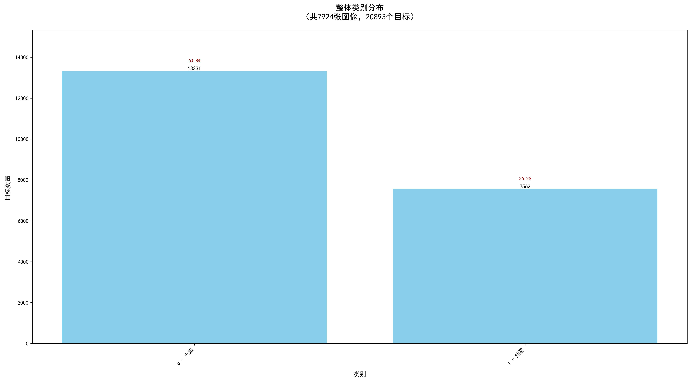

数据配置：

```yaml
path: datasets/dataset
train: images/train
val: images/val
test: images/test

nc: 2
names:
  0: Fire
  1: Smoke
```

YOLO标签与图片同名，每行记录类别、中心点坐标、宽度和高度，坐标均经过归一化。

## 图像预处理与增强

训练输入统一为**640×640**。预处理包含**Letterbox缩放补边、BGR转RGB和像素归一化**。

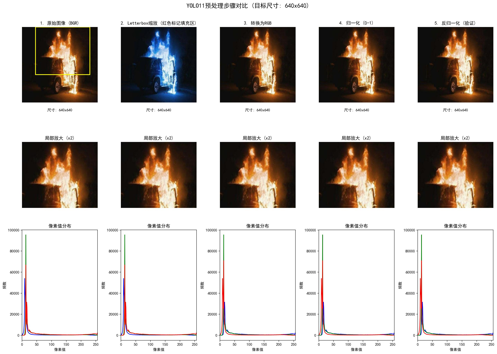

训练阶段使用旋转、平移、缩放、翻转和模糊等增强。

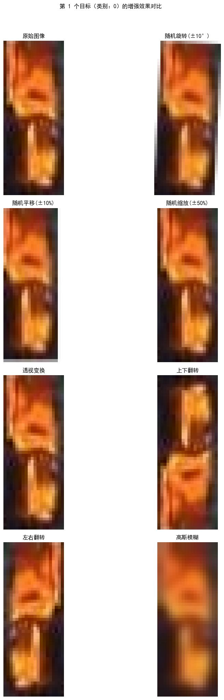

训练批次可视化用于检查图片加载、类别编号和检测框位置。

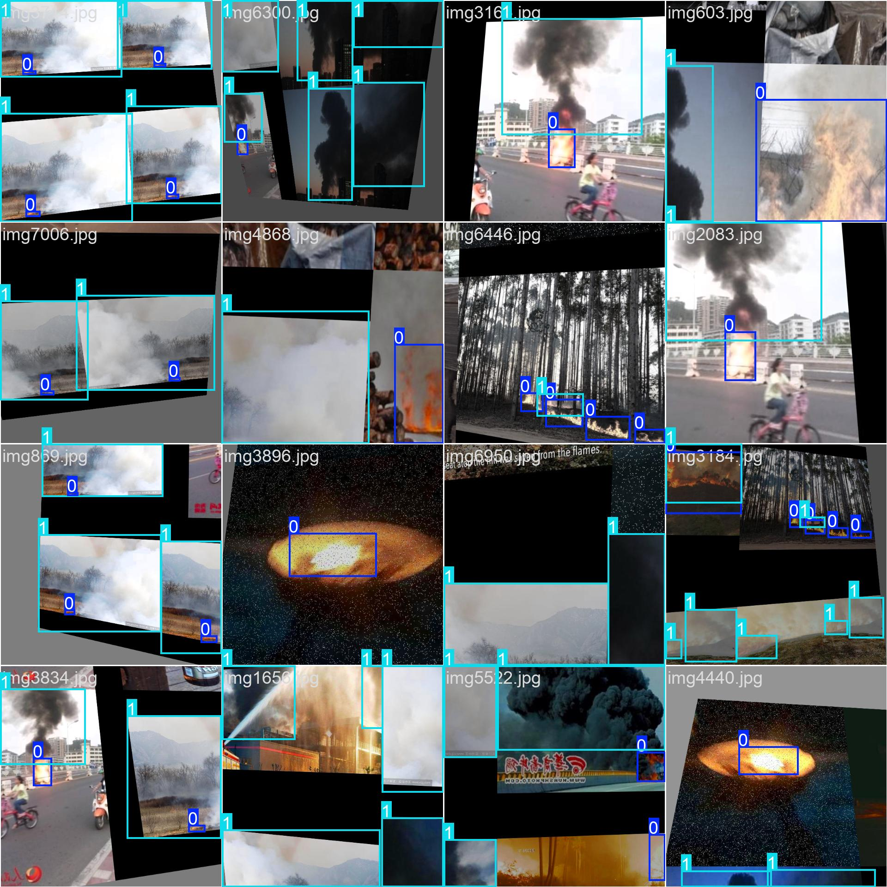

## 训练配置

三个版本使用相同的数据划分和主要训练配置：

```python
imgsz = 640
batch = 16
optimizer = "SGD"
lr0 = 0.01
warmup_epochs = 3.0
```

实际完成轮次：

| 版本 | 完成轮次 |
|---|---:|
| YOLOv8 | 149 |
| YOLO11 | 140 |
| YOLO26 | 146 |

训练输出位于`runs/train/exp`，主要文件包括：

```text
runs/
├── train/exp/
│   ├── weights/
│   │   ├── best.pt
│   │   └── last.pt
│   ├── args.yaml
│   ├── results.csv
│   └── results.png
└── val/exp/
    ├── BoxPR_curve.png
    ├── confusion_matrix.png
    └── val_batch*_pred.jpg
```

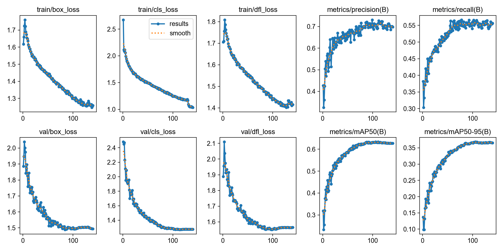

## 验证结果

各版本最后一轮主要指标：

| 版本 | Precision | Recall | mAP50 | mAP50-95 |
|---|---:|---:|---:|---:|
| YOLOv8 | 0.67924 | 0.57659 | 0.62644 | 0.35827 |
| YOLO11 | 0.69793 | 0.55655 | 0.62675 | 0.36562 |
| YOLO26 | 0.70486 | 0.54801 | 0.60378 | 0.35482 |

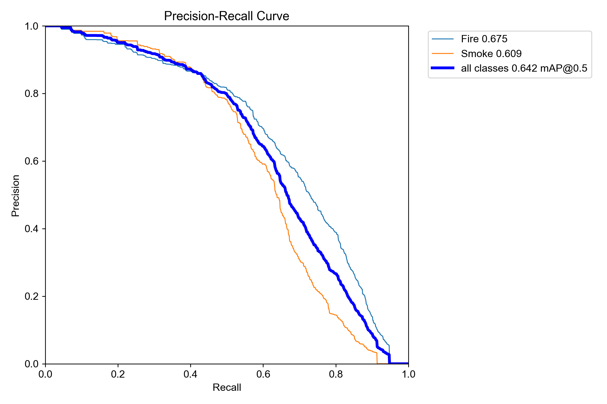

YOLO11独立验证中，**Fire AP50为0.675，Smoke AP50为0.609，全部类别mAP@0.5为0.642**。

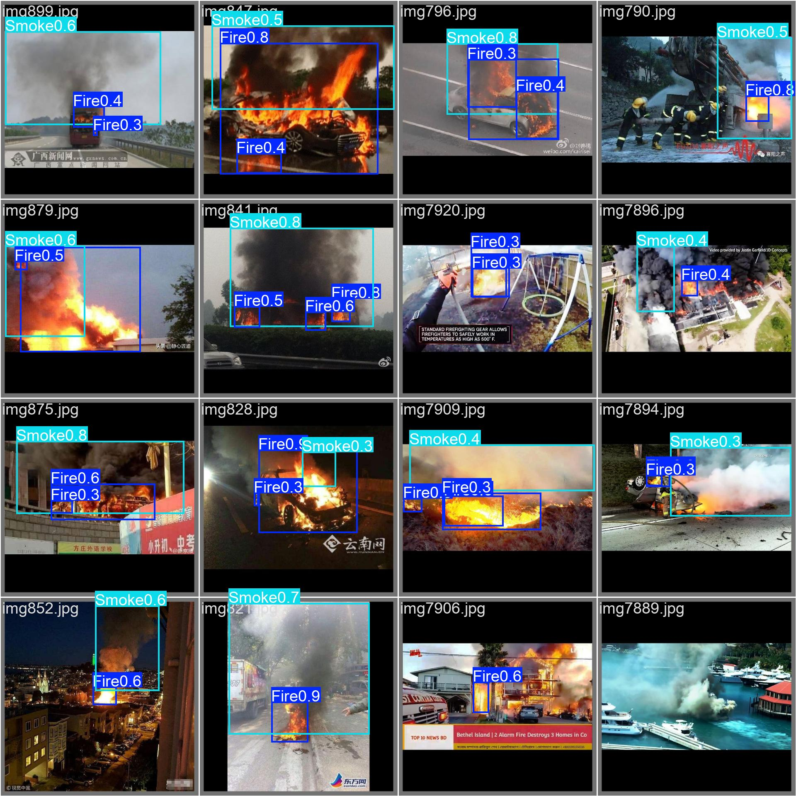

指标只描述当前数据和评价方式下的检测结果。三个版本各有侧重，不能根据版本名称直接推断所有指标同步提高。

## 系统架构

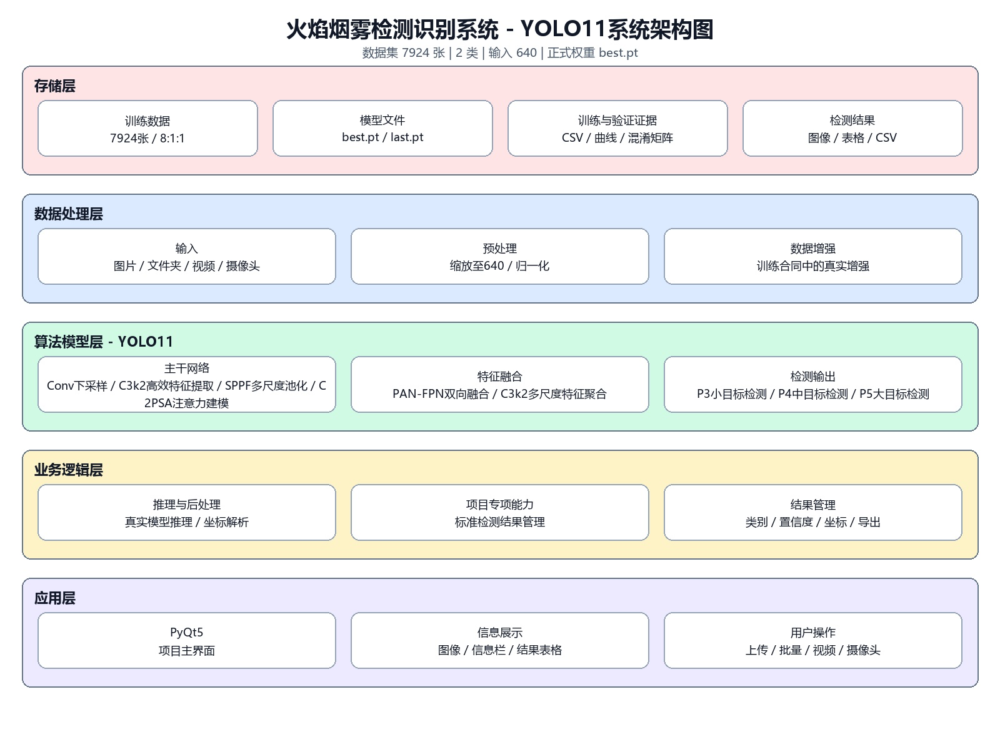

系统按存储、数据处理、算法模型、业务逻辑和应用界面分层。`项目配置.yaml`负责绑定当前版本权重与阈值，`main.py`负责输入管理、推理和结果回填，`ui.py`负责界面布局。

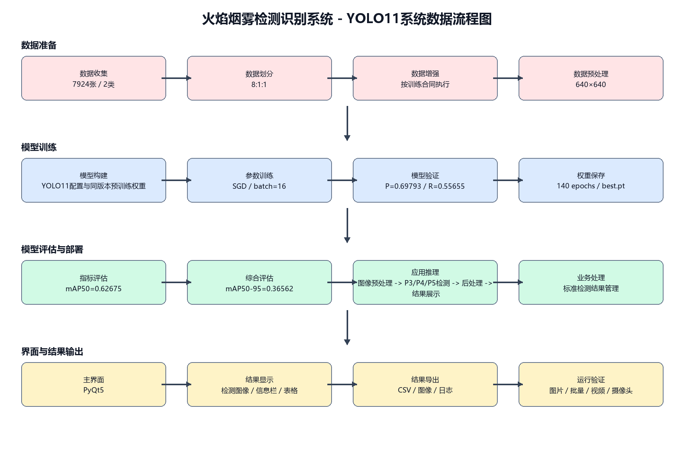

```text
用户输入
  ├─ 单张图片
  ├─ 图片文件夹
  ├─ 视频
  └─ 摄像头
        ↓
预处理 → YOLO推理 → NMS与坐标解析
        ↓
检测框、类别、置信度
        ↓
PyQt5图像区与表格
        ↓
CSV导出
```

## 三个版本

### YOLOv8

适合任务书明确指定YOLOv8，或需要使用资料较多的成熟版本。

### YOLO11

本文和运行视频的主要演示版本。代码目录、训练曲线、独立验证和PyQt5界面能够完整对应。

### YOLO26

适合任务书指定YOLO26，或需要在同一数据集和相同界面功能下做版本对比。

三个版本均有独立模型代码、权重和训练记录；界面操作保持一致。

## 运行逻辑

公开仓库是项目说明页；下面的命令用于已经取得完整项目文件后的本地运行。项目推荐Python 3.11，在对应版本项目根目录执行：

```bash
conda create -n fire-smoke python=3.11 -y
conda activate fire-smoke
pip install -r requirements.txt
python main.py
```

项目内已经包含适配后的`ultralytics`源码，不需要单独安装同名PyPI包。完整项目中按以下顺序检查：

1. 使用对应版本的Python环境；
2. 确认`项目配置.yaml`中的权重路径；
3. 运行`main.py`；
4. 分别测试单图、文件夹、视频和摄像头；
5. 保存一次CSV结果；
6. 需要重新训练时再运行`train.py`，验证时运行`val.py`。

独立推理也可以从`predict.py`进入，用于把模型输出与界面逻辑分开检查。

### 常见运行检查

- 权重未加载：检查`项目配置.yaml`中的路径，并确认对应版本`best.pt`存在；
- 摄像头无法打开：关闭其他占用摄像头的软件后重试；
- 提示缺少Python模块：确认PyCharm解释器使用的是刚创建的环境，再执行一次`pip install -r requirements.txt`。

## 适用方向

- 火焰目标检测；
- 烟雾目标检测；
- 安全场景计算机视觉课程设计；
- YOLO多版本实验对比；
- YOLO + PyQt5桌面应用；
- 数据集、训练、验证与软件展示一体化的毕业设计。

## 关键文件怎样对应

`myvoc.yaml`负责数据路径和类别名称，数据集变化时先检查这里；`train.py`负责启动训练，训练参数和实际运行结果还会写入`runs/train/exp`；`val.py`使用指定权重完成独立验证，验证曲线和批量预测图位于`runs/val/exp`。

界面部分以`main.py`为入口。它读取`项目配置.yaml`中的权重和阈值，接收图片、文件夹、视频或摄像头输入，再把模型输出转换成检测框和表格行。`ui.py`主要处理窗口布局和控件，不承担模型训练。把这几类文件分开看，能避免在界面代码里寻找训练参数，或者在训练脚本里寻找按钮逻辑。

## 怎样核对当前结果

查看模型效果时，建议同时核对三类文件：`results.csv`给出逐轮数字，`results.png`展示训练趋势，`runs/val/exp`中的PR曲线和预测批次展示独立验证结果。只看`best.pt`文件是否存在，无法判断数据是否正确读取，也无法解释三个版本之间的差异。

界面运行时则先确认窗口标题和配置中的版本一致，再检查加载的权重路径。完成单图测试后继续测试文件夹中断、视频关闭、摄像头关闭和CSV保存，这样能够覆盖项目中最主要的交互链路。

## 项目代码获取

**项目代码与完整资料：**[火焰烟雾检测识别系统](https://smallerkong.com/s/gh-yolo-fire-sm-118b32)

