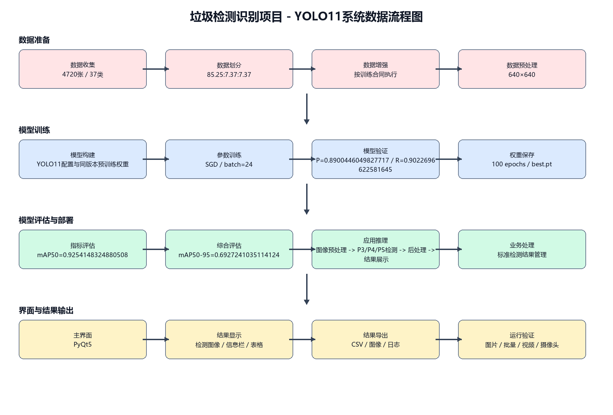
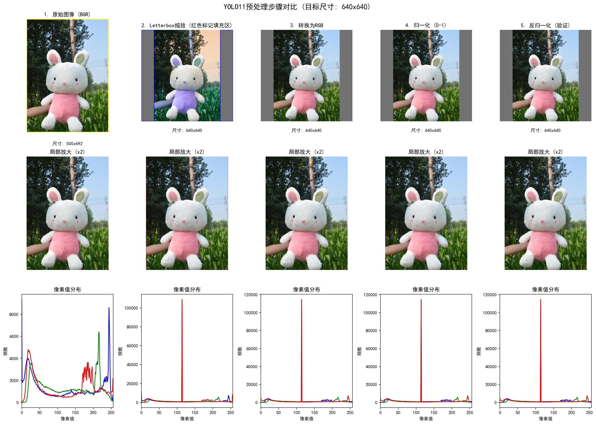
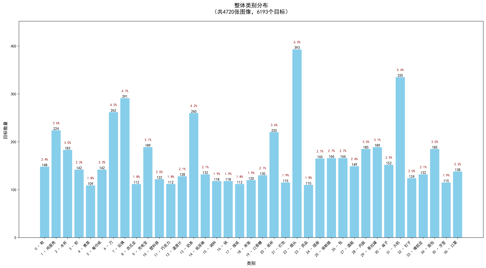
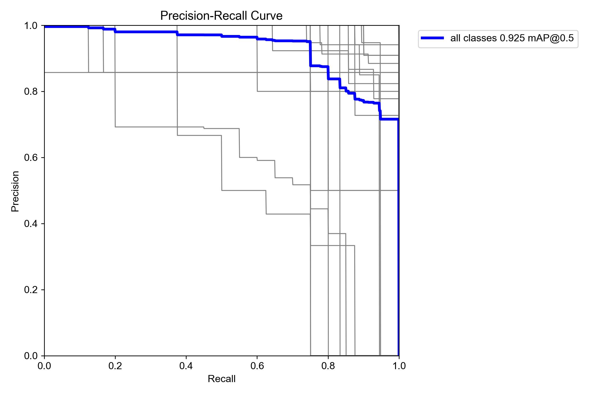

# YOLO多版本垃圾检测识别系统（PyQt5）

## 项目概述

这是一个覆盖数据、训练、验证、推理和PyQt5界面的完整垃圾检测识别项目。实际鸡蛋壳运行结果会在结果栏和表格同时显示细分类“鸡蛋壳”与大类“厨余垃圾”。YOLO负责检测**37个具体垃圾类别**，业务映射继续给出**厨余垃圾、有害垃圾、可回收物、其他垃圾**，界面同步展示检测框、置信度、坐标和明细表，并支持导出CSV。

项目提供**YOLOv8、YOLO11、YOLO26、YOLO11+CBAM**四个独立版本。各版本使用同一数据划分与主要界面流程，代码、权重、训练记录和验证指标分别保存。

## 核心功能与运行数据合同

一条检测记录包含以下字段：

| 字段 | 来源 | 用途 |
|---|---|---|
| 文件路径 | 当前输入 | 追溯图片或帧来源 |
| 识别结果 | YOLO类别 | 保留37类具体名称 |
| 垃圾类别 | 业务映射 | 厨余、有害、可回收或其他 |
| 置信度 | 检测框输出 | 判断当前预测可信度 |
| 坐标位置 | 检测框输出 | 标记目标位置 |

```text
图片 / 文件夹 / 视频 / 摄像头
              ↓
      预处理与模型推理
              ↓
 类别ID、置信度、检测框坐标
              ↓
 具体名称 + 四分类垃圾类别
              ↓
  图像区、结果栏、表格、CSV
```



## 四分类映射

`waste_category.py`维护类别ID到垃圾大类的唯一映射，`main.py`在生成检测记录时调用查询函数。模型类别不会被四分类覆盖。

```python
from waste_category import get_waste_category

record = [
    index,
    file_path,
    class_name,
    get_waste_category(class_id),
    confidence,
    box_coordinates,
]
```

代表性映射如下，实际文件包含37个类别：

| 细分类示例 | 垃圾大类 |
|---|---|
| 鸡蛋壳、虾、西瓜皮、米饭、香蕉皮 | 厨余垃圾 |
| 温度计、灯泡、药 | 有害垃圾 |
| 水杯、报纸、酒瓶、易拉罐 | 可回收物 |
| 餐巾纸、烟头、口罩 | 其他垃圾 |

异常或无法转换的类别ID回退为“其他垃圾”，避免单条错误打断界面流程。若重新训练并改变类别顺序，必须同步更新映射文件。

## 运行证据

鸡蛋壳检测中，左侧结果栏显示细分类“鸡蛋壳”和大类“厨余垃圾”，表格中的每个目标也写入垃圾类别。


香蕉皮示例用于检查映射与界面状态是否会随输入更新。


运行视频：

```text
https://www.bilibili.com/video/BV1n3YM6CEVo/
```

视频以YOLO11界面演示单图、批量图片、视频、摄像头、四分类显示与结果保存。其余版本保留相同的主要操作流程，各自加载对应权重。

## 快速运行

```bash
conda create -n garbage-yolo python=3.11 -y
conda activate garbage-yolo
pip install -r requirements.txt
python main.py
```

若程序未加载模型，先检查`项目配置.yaml`中的权重相对路径，再确认终端、IDE和安装依赖使用的是同一个Python解释器。加载现成权重可用普通电脑演示；重新训练建议使用NVIDIA GPU。

## 关键文件


```text
项目根目录/
├── main.py                    # 推理、事件、结果记录与CSV
├── ui.py                      # PyQt5布局与垃圾类别显示位
├── waste_category.py          # 37类到四分类的映射
├── train.py / val.py          # 训练与独立验证
├── predict.py                 # 独立预测
├── config_utils.py            # 配置读取
├── 项目配置.yaml               # 权重、阈值、界面标题、中文类别
├── myvoc.yaml                 # 数据路径与37类名称
├── datasets/                  # YOLO图像与标签
├── runs/                      # 权重、results.csv、验证图表
├── test_images/ / test_video.mp4
└── 数据指标图表/
```

查看新增四分类链路：`waste_category.py → main.py → ui.py`。

查看模型训练链路：`myvoc.yaml → train.py/val.py → runs`。

## 数据与训练基线

清洗后原始图像为**3462张**，增强后总计**4720张**。

| 子集 | 图像数 |
|---|---:|
| train | 4024 |
| val | 348 |
| test | 348 |

输入图像统一到640×640，预处理包含缩放、Letterbox补边、颜色空间转换和归一化。



37类样本量并不完全一致，类别分布应与混淆矩阵一起检查。



四个版本均完成100轮训练，公共参数为：

```yaml
epochs: 100
imgsz: 640
batch: 16
optimizer: SGD
lr0: 0.01
```

## 独立验证矩阵

| 版本 | Precision | Recall | mAP50 | mAP50-95 |
|---|---:|---:|---:|---:|
| YOLOv8 | 0.9297 | 0.8873 | 0.9348 | 0.6773 |
| YOLO11 | 0.8900 | 0.9023 | 0.9254 | 0.6927 |
| YOLO26 | 0.9003 | 0.9046 | 0.9325 | 0.7151 |
| YOLO11+CBAM | 0.8871 | 0.8922 | 0.9419 | 0.7046 |

YOLO26的mAP50-95最高；YOLO11+CBAM的mAP50最高；YOLOv8的Precision最高。不存在所有指标都最高的单一版本。

YOLO11+CBAM在YOLO11的P3高分辨率融合位置加入通道与空间注意力。相同设置下，mAP50-95由0.69272变为0.70464，绝对增加约0.01191，参数量增加610。结论仅适用于当前数据与训练配置。



## 版本选择

| 需求 | 建议版本 |
|---|---|
| 任务书指定YOLOv8 | YOLOv8 |
| 使用常用结构完成系统 | YOLO11 |
| 使用YOLO26或进行多版本比较 | YOLO26 |
| 展示注意力机制与基线对照 | YOLO11+CBAM |

## 验证四分类改造

1. 从四个垃圾大类各选择至少一个类别ID，检查映射返回值。
2. 分别运行单图、批量图片、视频和摄像头，确认记录结构一致。
3. 点击不同表格行，确认结果栏垃圾类别跟随当前行。
4. 清空结果，确认新增Label不会保留旧值。
5. 导出CSV，确认“识别结果”和“垃圾类别”为独立列。

## 使用边界

- 当前完成本地PyQt5检测与结果导出，不包含账号系统、数据库、云端接口或嵌入式部署。
- 四分类是37类检测结果的业务映射，不代表模型指标因界面改造而提高。
- 四个版本共享数据划分与主要界面功能，但代码、权重、训练记录和指标必须保持版本对应。
- 修改数据类别或顺序后，要同时更新数据配置、模型权重、中文名称与四分类映射。

## 项目代码获取

项目代码与完整资料：https://smallerkong.com/s/gh-yolo-garbage-8f88e2

