# YOLO交通标志检测识别系统：完整项目内容与构建流程

本项目使用Python、YOLO与PyQt5，对道路场景中的45类交通标志进行检测，支持图片、文件夹、视频和摄像头输入，显示结果并保存当前表格。我是孔一学长，这份文档按完整工程介绍代码、数据、权重、训练验证和界面实现，供课程设计与项目实践查阅。

**YOLOv8s、YOLO11s、YOLO26s**分别保留项目目录和正式权重。当前公开页面展示项目说明与证据图片；以下命令适用于取得完整项目文件后的本地目录，公开介绍页不包含整套源码、数据集和权重。

## 项目能力与演示

系统提供输入选择、模型文件选择、置信度调节、图像标注、结果明细和CSV保存。下面是YOLO11版实际界面，左侧为目标信息，中间为图像，下方为表格。

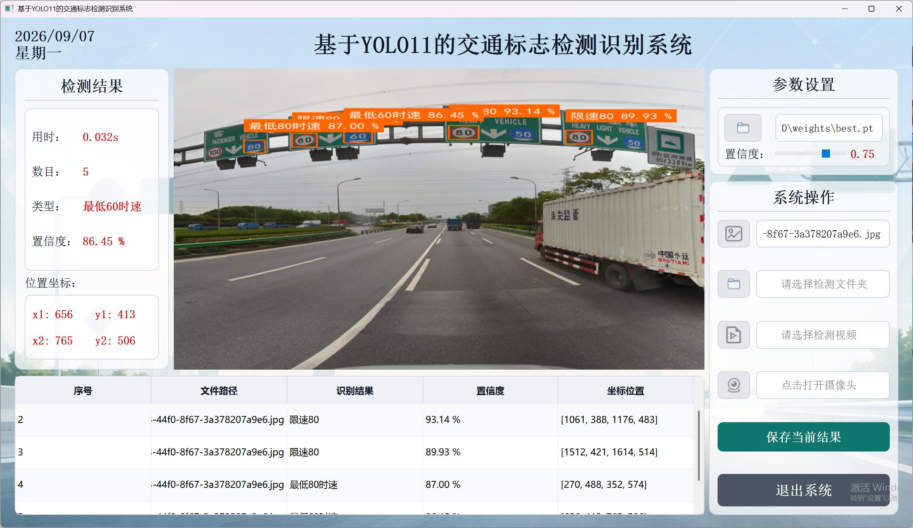

正式运行视频展示单图、文件夹、结果保存及视频检测，实际采用YOLO11版，三版具有相同类型的操作入口：

https://www.bilibili.com/video/BV1oLpM6CEpL/

## 从目录了解完整工程

项目包含运行代码，也保留训练与评价所需材料。核心构建路线为**数据准备→预处理与增强→模型训练→权重验证→界面集成**，各阶段可以按下面目录定位。

```text
项目根目录/
├─ main.py / ui.py / ui/       界面入口与组件
├─ 项目配置.yaml               权重路径、阈值、中文类别
├─ config_utils.py             配置读取与路径解析
├─ myvoc.yaml                  45类数据集定义
├─ datasets/dataset/           images与labels及数据划分
├─ train.py / val.py / predict.py
├─ runs/train/                 训练曲线与weights/best.pt
├─ runs/val/                   复评指标与混淆矩阵
├─ test_images/ / test_video.mp4
├─ outputs/                    检测结果CSV
├─ 数据指标图表/                架构及数据统计图
└─ 【打开后必看-带你一步步运行使用】/
```

`myvoc.yaml`定义数据，`train.py`产生权重和训练记录，`val.py`保存评价结果，`main.py`将推理接入界面。`项目配置.yaml`管理运行时的模型路径、阈值与显示名称，`config_utils.py`按项目根目录解析相对路径。

测试图像和视频用于检查输入及显示流程；必看说明目录提供使用资料。移动整个项目时需保留权重、字体和界面资源的相对位置。

## 环境与运行入口

建议使用**Python 3.11**及独立环境，核对本机PyTorch与计算环境。`requirements.txt`包含torch、torchvision、PyQt5、OpenCV、PyYAML等；完整包自带`ultralytics`源码。

```shell
python -m pip install -r requirements.txt
python train.py --check-only
python main.py
```

第二条只检查训练入口所需模型能否加载，不开始正式训练。界面启动还需要`项目配置.yaml`中的正式权重存在；YOLO11默认使用`runs/train/exp_yolo11s_main200/weights/best.pt`。

先选择`test_images`中的样例，确认标注图和表格都有结果，再测试文件夹与视频。摄像头功能依赖本机存在可用采集设备。

## 具体支持哪些交通标志

以下按阅读用途列出当前配置中的全部45类名称；三版本类别配置一致。分组不改变`nc=45`和原类别编号。数据集缩写保留在`myvoc.yaml`中，中文显示名以`项目配置.yaml`为准。

- **限速与解除限速（10类）**：限速80、限速60、限速70、限速30、解除40限制速度、限速20、限速40、限速120、限速100、限速50。

- **最低时速（3类）**：最低80时速、最低60时速、最低100时速。

- **限高与限重（6类）**：限重55t、限高4m、限高4.5m、限重30t、限高5m、限重20t。

- **车辆通行限制（9类）**：禁止非机动车进入、禁止驶入、禁止二轮摩托车、禁止小型客车、禁止人力车、禁止机动车、禁止载货汽车、禁止载货汽车和拖拉机、禁止运输危险物车辆。

- **转向、停车与鸣笛限制（5类）**：禁止掉头、禁止鸣笛、禁止左转、禁止车辆临时或长时停放、禁止右转。

- **通行与车道指示（6类）**：人行横道、非机动车车道、机动车行驶、机动车车道、非机动车行驶、靠右行驶。

- **警示与让行（6类）**：减速让行、十字交叉、注意儿童、施工、注意行人、注意合流。

上述名称是当前项目的显示范围。接口结果按原类别编号输出；修改数据集时须同步数据标签、`nc`与名称顺序，再进行模型训练。

## 配置数据集

数据根目录为`datasets/dataset`，由`myvoc.yaml`指定。类别数为**45**，images和labels按相同划分对应保存。

| split | 图像数 |
|---|---:|
| train | 6793 |
| val | 1949 |
| test | 996 |
| 合计 | 9738 |

三个版本使用相同划分规模。替换数据时，先核对图片与标签对应关系、类别编号和配置路径，再启动训练。类别名称顺序应与模型任务一致。

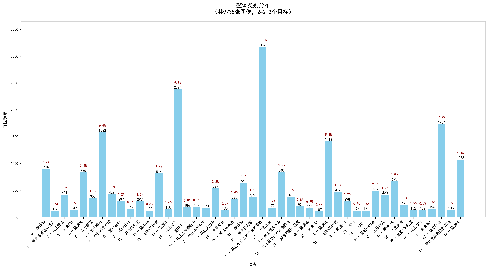

上面的类别分布图按标注目标数统计，一张图像可含多个目标，因此图像数量和目标数量需区分。检查样本时，可以优先查看数量较少的类别。

### 样本与标注格式

下面的图来自正式验证目录`val_batch0_labels.jpg`，展示16张道路样本及其真实标签。保留文件名便于回到数据集核对；这张图不是模型预测。

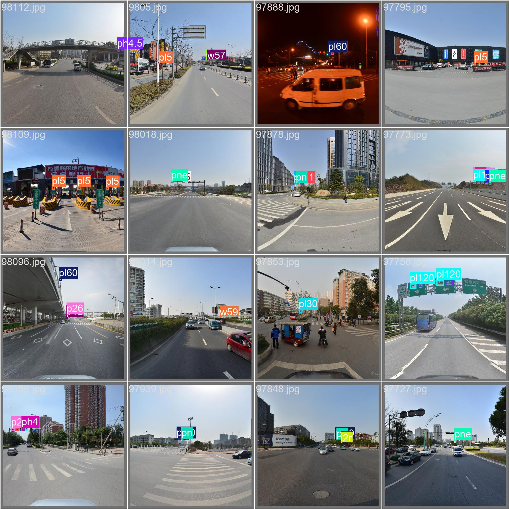

以`datasets/dataset/images/val/98112.jpg`为例，其同名标签文件内容为：

```text
15 0.955077 0.391276 0.022137 0.027344
```

字段依次为`class_id x_center y_center width height`，坐标和尺寸以图像宽高归一化。类别15对应限高4.5m。每行描述一个目标，图像和标签按文件名配对。

样本中包含白天与夜间、城市道路和高速路段。可从图中观察远处标志、同屏多个目标和背景差异；检查样本时，可按这些可见差异逐图查看。

### 预处理可视化

`数据指标图表/process_vis.py`用于观察原图、LetterBox缩放、BGR/RGB通道处理与数值归一化。示例目标尺寸为640×640，最后的反归一化列仅用于可视化检查。

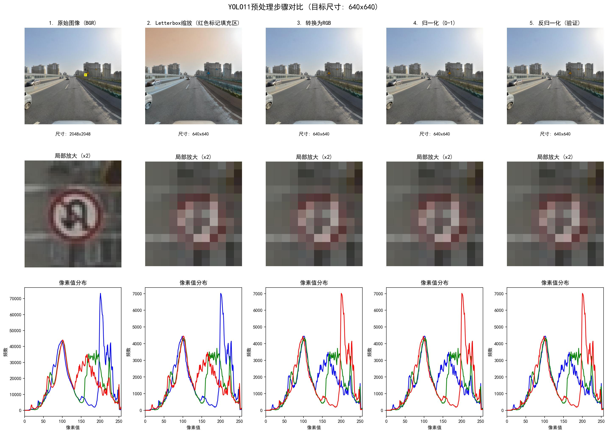

中排展示同一小目标的局部，对照缩放前后的可见细节；底排展示像素分布。图片用于解释输入处理，不能从可视化本身推断模型精度。

### 增强示意与训练实物

项目的`img_augment_vis.py`对裁剪目标绘制变换对照，下图目标编号为类别14，即禁止驶入。旋转、位移、尺度和方向变化可以逐格比较。

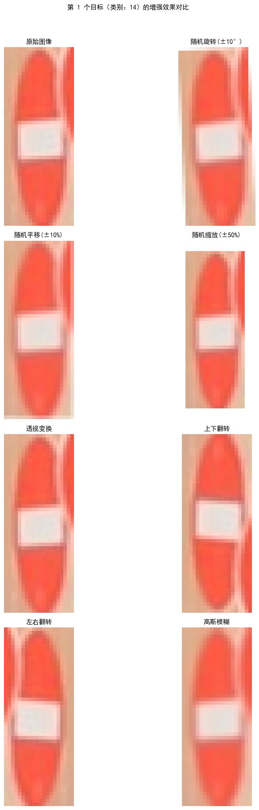

图中的高斯模糊属于可视化示例。实际实验以`train.py`和训练参数为准，主要设置在下一节列出。

`train_batch0.jpg`则是正式训练保存的实际批次，包含多图拼接和几何变换后的图像与标注。

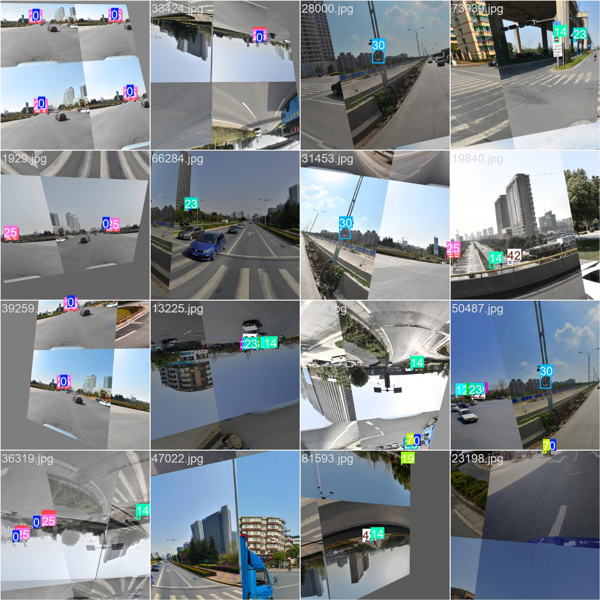

排查自定义数据训练时，先检查这种批次图中目标与框是否对应，再检查损失。方向性标志的翻转应单独核对语义；增强是否改善结果，需要另做对照实验。

## 训练和验证命令

三个正式版本均设置200轮训练。YOLO11入口从本地`yolo11s.pt`开始，主要训练参数如下：

| 参数 | 值 |
|---|---|
| epochs / imgsz / batch | 200 / 640 / 16 |
| optimizer / lr0 | SGD / 0.01 |
| momentum / weight_decay | 0.937 / 0.0005 |
| warmup_epochs / close_mosaic | 3 / 10 |
| seed / deterministic | 0 / True |

增强设置可在`train.py`中查看：

| 参数 | 值 |
|---|---:|
| degrees | 10 |
| translate | 0.1 |
| scale | 0.5 |
| mosaic | 1.0 |
| mixup | 0.1 |
| fliplr | 0.5 |
| flipud | 0.2 |

方向性标志经过翻转可能改变语义，调整训练方案时应核查这一点。当前参数是已保存实验的配置，不代表所有增强都已分别证明有效。

```shell
python train.py
python val.py
```

训练会写入实验目录。需要保留原结果时，使用`--name`指定新的实验名；验证新实验还应同步`val.py`中的权重路径与输出名。正式目录中保留**best.pt、last.pt、results.csv和训练曲线**。

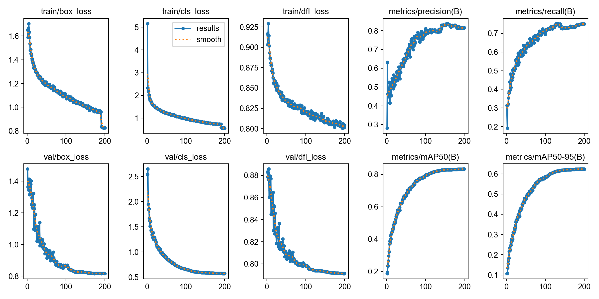

这张曲线图展示训练过程，用于观察损失与指标变化。三版本对照使用下一节的最终权重复评结果。

## 验证结果与统计口径

每版`val.py`加载本版`best.pt`，使用val划分、640输入、batch16、conf0.001、iou0.60，输出`runs/val/<实验名>/evaluation_metrics.json`及分类别结果。

| 模型 | Precision | Recall | mAP50 | mAP50-95 |
|---|---:|---:|---:|---:|
| YOLOv8s | 74.15% | 67.43% | 75.11% | 56.31% |
| YOLO11s | 81.67% | 74.89% | 83.28% | 63.23% |
| YOLO26s | 82.82% | 80.41% | 87.12% | 65.41% |

Precision观察预测正确性，Recall反映召回，mAP50和mAP50-95对应不同框匹配条件。上表是1949张验证图上的复评，不是996张测试图上的成绩。YOLO26s在本次验证中的总体指标较高。

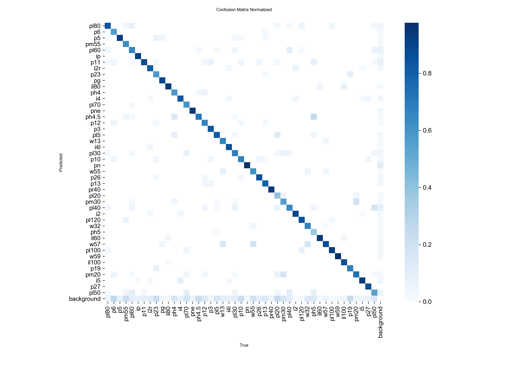

矩阵横轴为真实类别、纵轴为预测类别，可结合非对角线与背景相关项继续检查错误。复现时保持权重、数据划分和评估参数一致。

### 评价产物与样本对照

同一验证目录提供`BoxPR_curve.png`。横轴Recall、纵轴Precision；灰线显示分类别曲线，蓝线展示整体，图例0.833对应表中83.28%的舍入值。

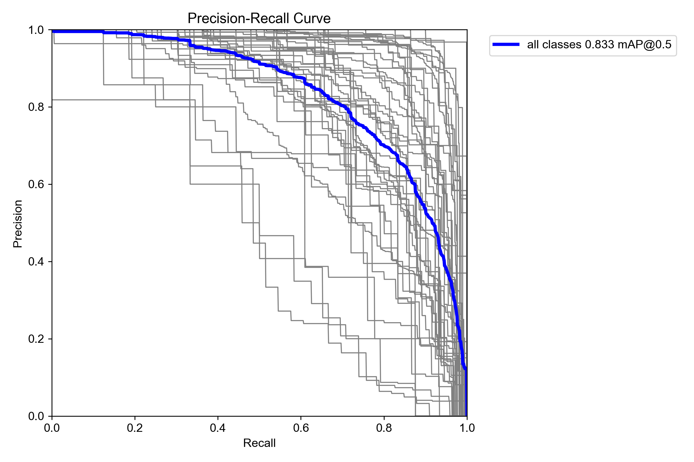

总体指标用于版本比较，PR曲线用于查看Precision与Recall的关系，混淆矩阵用于定位类别错误。保持同一权重和数据划分后，这些文件可相互对照。

下面是同目录的`val_batch0_pred.jpg`，与数据章节的`val_batch0_labels.jpg`逐图对应。两者分别是预测结果与真实标签；预测图还标注置信度。

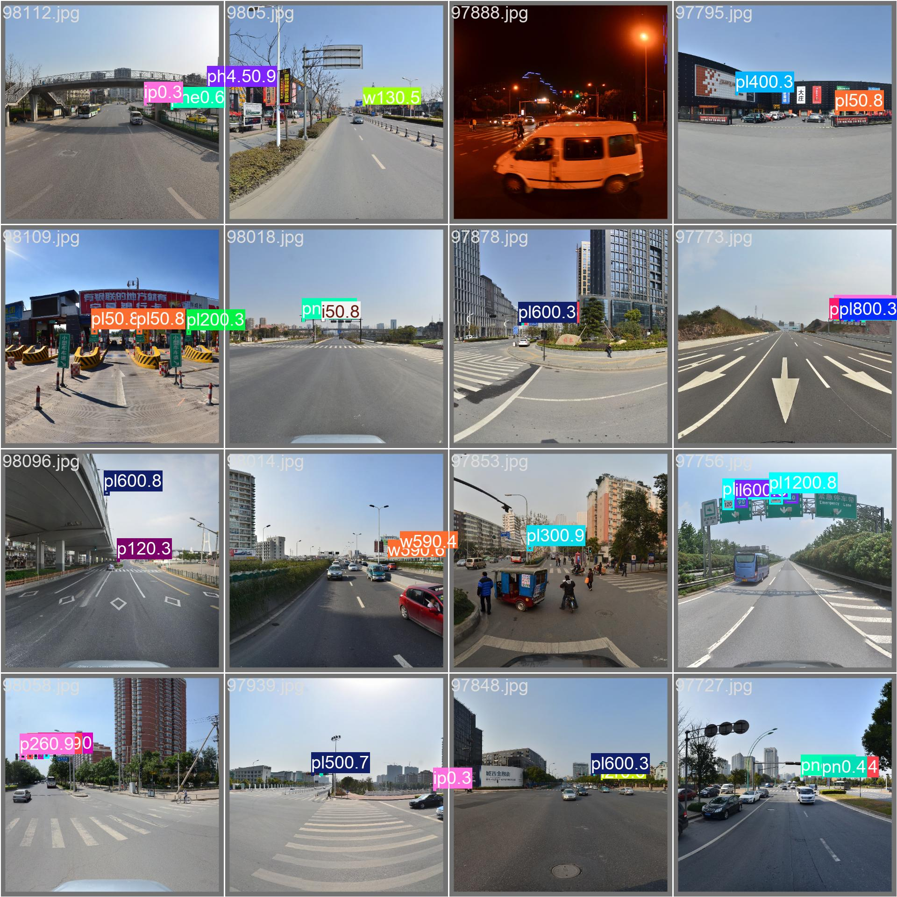

按文件名回到原图及标签，可检查目标位置、类别和漏检。验证批次输出与桌面界面的显示用途不同，不应把两套阈值下的框数量直接比较。

## 模型与界面如何衔接

以YOLO11为例，模型进行特征提取、多尺度特征融合及目标检测，返回框、类别和置信度；应用程序解析这些输出并更新图像、信息栏和表格。

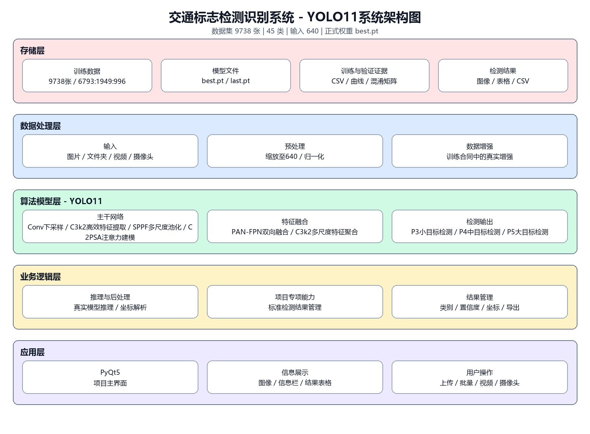

`main.py`中的`detect_pic()`负责推理调用：

```python
self.results = self.yolo(
    img_path, conf=self.model_conf, iou=self.model_iou
)[0]
```

之后读取`boxes.xyxy`、`boxes.cls`和`boxes.conf`。中文类别名从配置读取，用于绘制文字及填入明细。视频与摄像头通过采集和定时刷新继续送帧。

界面默认conf0.5、iou0.5；实际截图的置信度调到了0.75。运行展示的过滤阈值与模型评价参数分工不同，核对框数时要先检查输入、权重和阈值。

## 输出文件约定

| 内容 | 实际行为 |
|---|---|
| 显示 | 标注图像、目标信息、结果表格 |
| CSV来源 | 当前表格非空行及表头 |
| 保存路径 | outputs/detection_results.csv |
| 编码 | utf-8-sig |
| 重复保存 | 覆盖同名文件 |

保存逻辑位于`save_current_result()`，先写临时文件再替换目标文件。它不是自动累积所有视频历史结果；如要长期保存多次检测，应另外安排文件命名或追加策略。

## 版本范围与项目代码获取

当前包含三个**s规模基础版本**，各自有代码、正式权重和训练验证产物。YOLO11可对应当前演示，YOLOv8可作版本实验，YOLO26可研究本次指标差异；三个版本均围绕这45类交通标志检测任务构建。

项目适合目标检测课设、多版本实验及PyQt5应用开发。完整资料包括源码、数据集、权重、实验结果、测试素材和使用说明，便于沿数据、训练、评价和应用逐层阅读，项目库中还有其他方向可查看。

项目代码与完整资料：https://smallerkong.com/s/gh-yolo-traffic-46a5b0
