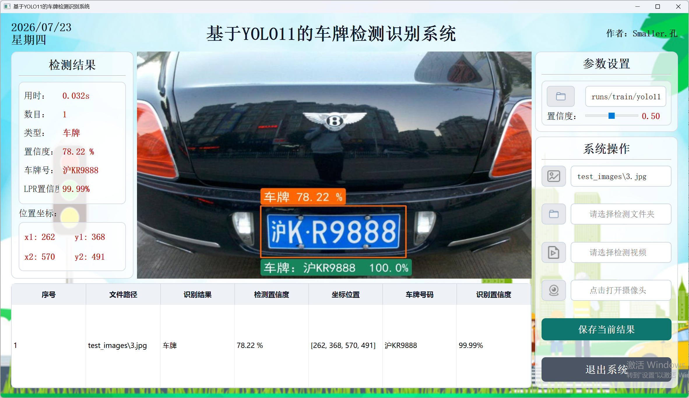
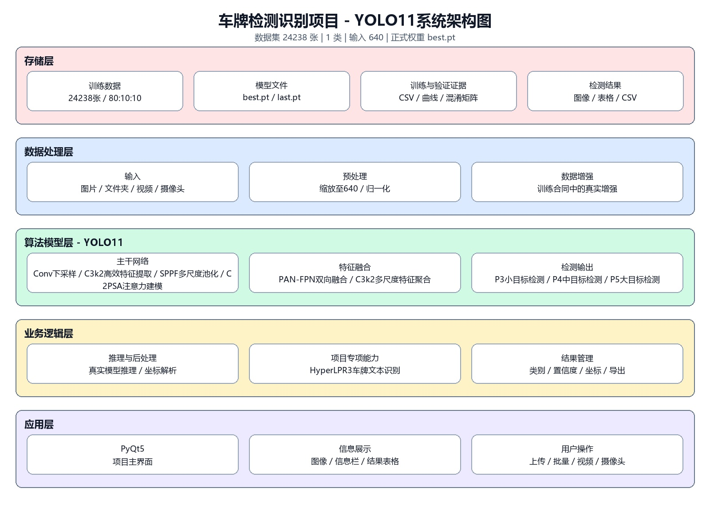
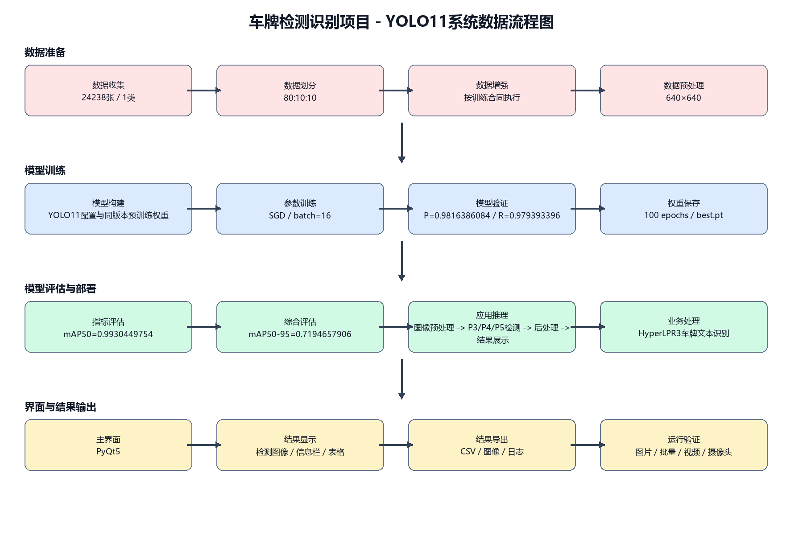
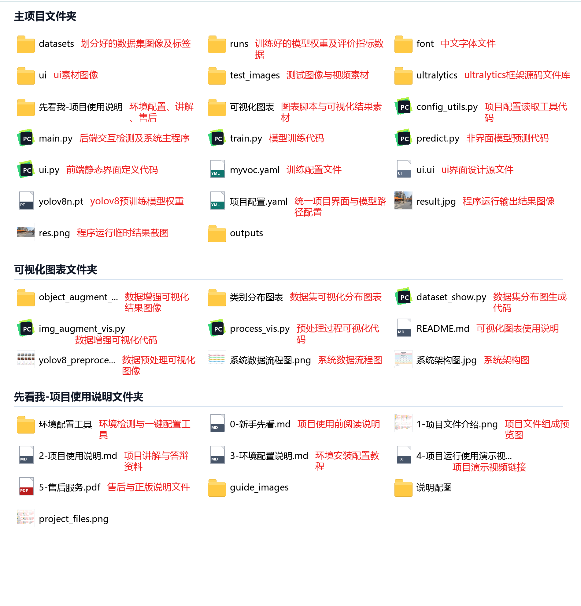
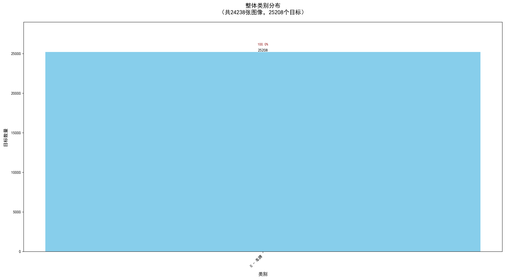
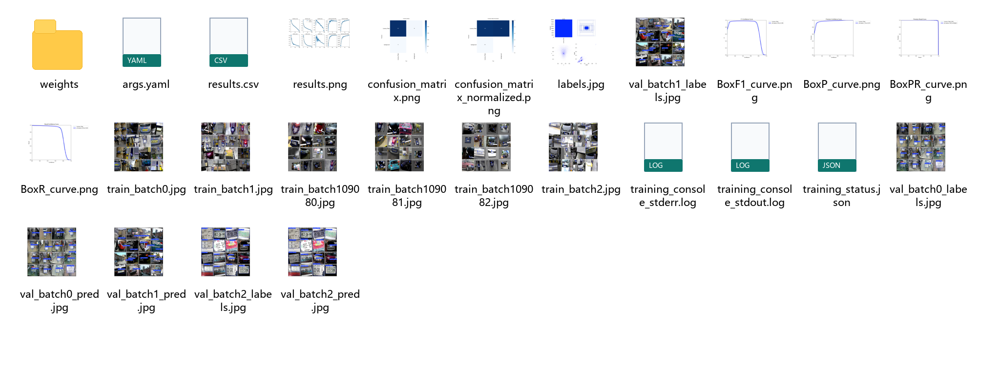
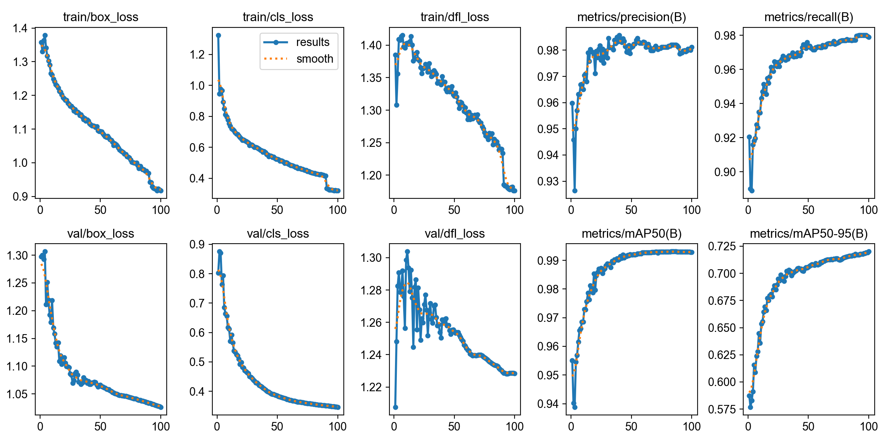

# YOLO多版本车牌检测识别系统：Python、HyperLPR3与PyQt5界面

一个面向课程设计与毕业设计的Python车牌检测识别项目。系统使用YOLO定位车牌，使用HyperLPR3识别车牌文字，并通过PyQt5提供单图、批量图片、视频、摄像头检测和CSV结果导出。

项目整理了四个可独立运行的版本：YOLOv8、YOLO11、YOLO26和YOLO11+SE注意力改进版。本文档以YOLO11为例说明目录、数据、训练、推理和配置方式。

## 运行效果



运行效果视频：[在B站查看单图、批量图片、视频检测和结果导出演示](https://www.bilibili.com/video/BV1CC896qEsb/)。视频以YOLO11版本演示，其他版本的功能入口和操作方式基本一致。

界面同时显示：

- YOLO车牌检测框与检测置信度；
- HyperLPR3车牌文字与识别置信度；
- 检测坐标、耗时和结果表格；
- 单图、批量图片、视频及摄像头入口；
- CSV结果保存。

检测置信度和文字识别置信度来自两个不同模块。YOLO评价车牌区域定位，HyperLPR3评价字符识别，二者不能混用。

## 主要功能

| 功能 | 说明 |
|---|---|
| 单图检测 | 选择一张图片，显示车牌框、文字、置信度和坐标 |
| 批量检测 | 选择图片文件夹并逐张处理 |
| 视频检测 | 读取测试视频并逐帧更新结果 |
| 摄像头检测 | 打开本地摄像头读取实时画面 |
| 结果保存 | 将当前表格导出为CSV |
| 模型训练 | 提供训练、独立验证和预测入口 |
| 多版本 | YOLOv8、YOLO11、YOLO26、YOLO11+SE |

## 系统架构



```text
图片 / 文件夹 / 视频 / 摄像头
              ↓
          YOLO检测
              ↓
       获取并裁剪车牌区域
              ↓
       HyperLPR3文字识别
              ↓
       PyQt5界面与结果表格
              ↓
           导出CSV
```



检测层输出车牌边界框和检测置信度。`lpr_utils.py`根据坐标裁剪车牌区域，再调用HyperLPR3。PyQt5界面层接收标注后的图像、车牌文字、两类置信度和表格字段。

## 项目目录



```text
车牌检测_YOLO11_PyQt5_标准成品项目/
├── main.py                     # 程序入口与检测流程
├── ui.py                       # PyQt5界面
├── lpr_utils.py                # 车牌裁剪与HyperLPR3文字识别
├── train.py                    # YOLO模型训练
├── val.py                      # 独立验证
├── predict.py                  # 单独预测
├── config_utils.py             # 配置读取工具
├── 项目配置.yaml                # 模型路径、阈值和界面标题
├── myvoc.yaml                  # 数据集配置
├── requirements.txt            # Python环境依赖
├── datasets/                   # 图像和YOLO标签
├── runs/                       # 权重、日志和指标图
├── test_images/                # 单图与批量测试图片
├── test_video.mp4              # 测试视频
├── 数据指标图表/                # 架构、流程和实验图表
└── 【打开后必看-带你一步步运行使用】/ # 环境配置与使用说明
```

## 数据集

数据集包含24238张车牌图像：

| 数据部分 | 图像数量 |
|---|---:|
| 训练集 | 19390 |
| 验证集 | 2424 |
| 测试集 | 2424 |



YOLO检测任务只有一个类别：`License_Plate`。

```yaml
path: datasets/dataset
train: images/train
val: images/val
test: images/test

nc: 1
names:
  0: License_Plate
```

每张图像都有对应的YOLO TXT标签。使用自己的数据集时，需要同时替换图片和标签，再修改`myvoc.yaml`中的路径。

## 快速开始

### 1. 选择版本

四个版本分别放在独立项目文件夹中：

- YOLOv8
- YOLO11
- YOLO26
- YOLO11+SE

不要混用不同版本的权重和配置文件。

### 2. 配置Python环境

按照所选项目中的环境说明安装`requirements.txt`。

```bash
pip install -r requirements.txt
```

核心依赖包括Ultralytics YOLO、PyQt5、OpenCV和HyperLPR3。具体版本以所选项目的依赖文件为准。

### 3. 检查模型路径

`项目配置.yaml`保存当前使用的权重和检测阈值：

```yaml
model:
  name: YOLO11基础版
  algorithm: YOLO11
  weights: runs/train/yolo11_license_plate/weights/best.pt
  conf: 0.5
  iou: 0.5

lpr:
  enabled: true
  library: hyperlpr3
```

### 4. 启动程序

```bash
python main.py
```

建议先测试一张图片。确认检测、裁剪、文字识别和界面回填都正常后，再测试文件夹和视频输入。

## 模型训练与验证

YOLO11使用下面这组训练参数：

```python
epochs=100, batch=16, imgsz=640
optimizer='SGD', lr0=0.01, lrf=0.01
momentum=0.937, weight_decay=0.0005
warmup_epochs=3.0, cos_lr=True
seed=42, deterministic=True
```

训练、验证和预测入口：

```bash
python train.py
python val.py
python predict.py
```

`runs/train/yolo11_license_plate/`保存`best.pt`、`last.pt`、`results.csv`、训练参数、损失曲线、PR曲线和混淆矩阵。





## YOLO11验证结果

| 指标 | 结果 |
|---|---:|
| Precision | 0.9816 |
| Recall | 0.9794 |
| mAP50 | 0.9930 |
| mAP50-95 | 0.7195 |

这些指标评价车牌边界框检测，不评价OCR字符准确率。若要统计字符级准确率，需要另外准备带真实车牌文本的测试集。

## 主要程序函数

阅读`main.py`时，可以从下面这些函数梳理界面流程：

| 函数 | 作用 |
|---|---|
| `select_img()` | 选择并处理单张图片 |
| `select_folder()` | 批量处理图片文件夹 |
| `select_video()` | 打开测试视频 |
| `display_video_frame()` | 更新视频画面 |
| `button_open_camera_clicked()` | 控制摄像头输入 |
| `detect_pic()` | 执行YOLO检测、车牌裁剪、文字识别和结果回填 |
| `save_current_result()` | 导出结果表格 |

我建议按照`main.py → detect_pic() → lpr_utils.py → ui.py`的顺序阅读代码。这条路线能直接看到模型输出如何变成界面结果。

## 版本选择

| 版本 | 适用场景 |
|---|---|
| YOLOv8 | 课程任务明确要求YOLOv8 |
| YOLO11 | 完整训练、验证与PyQt5集成基线 |
| YOLO26 | 指定版本任务或受控多版本比较 |
| YOLO11+SE | 注意力机制改进与消融实验 |

SE版本在P3高分辨率融合位置加入通道注意力。同一验证方式下，mAP50-95从约0.71947提高到0.72676，增加约0.73个百分点；mAP50没有同步提高，因此不能写成所有指标全面提升。

## 常见问题

### 找不到权重文件

检查`项目配置.yaml`中的`weights`路径和IDE工作目录。相对路径以项目根目录为基准。

### 训练时找不到图片或标签

检查`myvoc.yaml`、`images/labels`目录结构，以及图片和标签是否同名。

### 能检测车牌但没有文字结果

检查HyperLPR3是否安装，并确认送入文字识别模块的车牌裁剪区域有效。

### 视频界面比YOLO单独推理慢

完整程序还要读取文件、裁剪车牌、执行OCR、绘制界面和更新表格。YOLO单独推理时间不等于界面端到端帧率。

## 使用范围与限制

项目用于学习、实验、课程设计和演示，没有经过道路执法或生产部署验证。夜间、严重遮挡、特殊车牌和跨域数据需要补充数据集并重新评估。

## 项目代码与说明

项目源码、数据集、训练权重、PyQt5界面、四个版本说明和配套讲解统一整理在项目详情页。更多面向国内大学生的深度学习课程设计与毕设项目代码，也可以从网站项目库继续查看。

[查看车牌检测识别系统项目详情与代码资料](https://smallerkong.com/s/gh-yolov8-car-p-e7508e)

